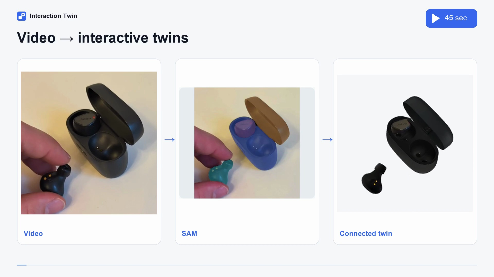
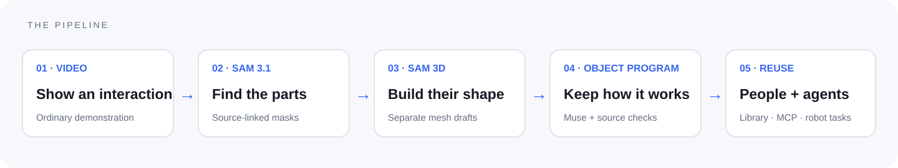

<p align="center"></p>

<h1 align="center">Interaction Twin</h1>
<p align="center"><strong>Show it once. Keep how it works.</strong></p>
<p align="center">A video in. An object program out.</p>

<p align="center">
  <a href="https://nigelhartman.github.io/interaction_twin/">Explore the demo</a> ·
  <a href="https://nigelhartman.github.io/interaction_twin/showcase/film.html">Watch the trailer</a> ·
  <a href="https://nigelhartman.github.io/interaction_twin/showcase/walkthrough.html">3-minute walkthrough</a>
</p>

[](https://nigelhartman.github.io/interaction_twin/showcase/film.html)

<p align="center">▶ <a href="docs/media/interaction-twin-45s.mp4">Open the trailer MP4</a> · Sound and English captions on the demo page.</p>

An object is more than its shape. A case opens on a hinge. Earbuds can be removed. A cable connects parts from different scenes. Reusing those interactions needs geometry, relationships, action order and evidence together.

**Interaction Twin prepares that context from ordinary demonstration video.** Inspect the source beside a connected 3D replay, download the parts and descriptive program, or let an agent search the same curated library through MCP.



## Try it

| Explore | What you can do |
| --- | --- |
| [Twin library](https://nigelhartman.github.io/interaction_twin/showcase/library.html) | Expand an example, compare video and replay, inspect parts and download GLB + JSON. |
| [Robotics lab](https://nigelhartman.github.io/interaction_twin/showcase/robotics-lab.html) | Explore recorded motion and a complete browser robot rehearsal. |
| [For agents](https://nigelhartman.github.io/interaction_twin/showcase/agents.html) | Copy the connection guide and inspect a saved cross-recording task draft. |

The public demo is **static and read-only**: five owner-recorded examples, saved model outputs and browser rendering. It runs no uploads, private admin service, paid model calls or hosted MCP server. Supported robot instructions compile locally; the page does not control hardware.

## From perception to reuse

1. **Find the parts.** Muse proposes components and prompts; SAM 3.1 segments visible components.
2. **Generate shape.** SAM 3D Objects produces separate mesh drafts from selected frames and masks.
3. **Connect motion and meaning.** Muse proposes relationships and actions. Local source and geometry checks estimate supported connections and motion.
4. **Review before publishing.** Separate Muse role prompts and deterministic checks critique a revision. Up to two targeted repair rounds can follow; the owner approves the exact result.
5. **Describe and reuse.** A source-linked object program keeps parts, estimated joints, steps and evidence together. People and agents retrieve the same curated version.

Feedback memory stores revocable guidance for later runs. It does not retrain model weights. Reviewer roles use separate prompts to the same Muse model; they are not independent models or a guarantee of correctness.

## More than a mesh

The descriptive format preserves:

- Original assets and separately declared refinements, with hashes and source lineage.
- Parent/child connections, joint frames, axes and angle samples where estimated.
- Removable parts, proposed relationships and demonstrated action steps.
- Timestamped evidence, unknown intervals and explicit physical-readiness flags.

See the [object-program format](docs/object-program.md), [MCP guide](docs/mcp.md) and [technical overview](docs/technical-overview-20261104.md).

For the earbud example, the lid follows its parent through an estimated revolute joint. Attachment is enforced by forward kinematics. That prevents independent lid drift, while the physical hinge location, metric dimensions and contact still require validation.

## One task, two recordings

**“Prepare a task to charge this phone.”**

The saved demonstration uses a real scripted MCP client to retrieve phone and charger records: **42 calls, six native model files and nine source images**, checked against their hashes. A deterministic compiler assembles a five-step draft from attributed interface descriptions and demonstrated steps. A separate Muse metadata critique flags unresolved compatibility.

This illustrates reuse across recordings. Shared cable identity, connector seating, electrical compatibility and successful charging remain unverified. The example is a saved retrieval trace, not a live autonomous robot.

## Repository layout

```text
README.md           Project overview and films
docs/               Architecture, formats and setup
app/                Python services, browser app, scripts and tests
```

`gh-pages` holds the separate static demo. Application commands run from `app/`.

## Run the source locally

The repository contains the custom application source. Saved demonstrations are deployed separately to the `gh-pages` branch; model weights, environments, credentials and private owner state are excluded.

Start with the [source setup guide](docs/source-setup.md). A prepared Python environment and FFmpeg are required; fresh model inference additionally needs Meta access and a configured GPU worker. No API key is required to browse the public demo.

```sh
git clone https://github.com/nigelhartman/interaction_twin.git
cd interaction_twin/app
# Follow docs/source-setup.md to prepare your environment.
python -B scripts/build_workspace.py --no-replays
python -B scripts/serve_workspace.py --host 127.0.0.1 --port 8766
```

Without separately supplied artifacts the source build opens an empty library. It does not recreate the hosted examples or start model calls automatically. Keep credentials outside Git and client code; use the documented local owner workflow before enabling processing.

## What works, and what comes next

**Today:** source-linked inspection, generated part downloads, estimated connected replay, a review/approval workflow, read-only agent access, cross-recording task drafts and editable browser robot rehearsals.

**Next:** better complete geometry, measured scale, independent joint-fit tests, validated grasp/contact and constrained insertion. The phone geometry and flexible-object reconstruction remain limited. Source-visible 2.5D surfaces are partial observations, separate from complete native models. Robot motion is authored kinematics, not a trained policy or physical-success claim.

## Built with Meta · built by Nigel

Created for the **Meta Global AI Developer Hackathon 2026**. Meta supplies Muse Spark, SAM 3.1 and SAM 3D Objects; additional upstream work includes CoTracker and Three.js. The custom contribution is the application, descriptive representation, orchestration, source checks, review workflow, curated library, MCP handoff and task authoring. Upstream models and SDKs remain the work of their authors; this project makes no world-first or benchmark-superiority claim.

See [attribution and release scope](docs/PUBLIC_RELEASE.md). There is currently no project-wide open-source license grant; dependency notices retain their own terms.

**Nigel Hartman** — XR and AI developer connecting spatial computing with practical machine learning.  
[Portfolio](https://nigelhartman.de) · [GitHub](https://github.com/nigelhartman) · [LinkedIn](https://www.linkedin.com/in/nigelhartman/)
